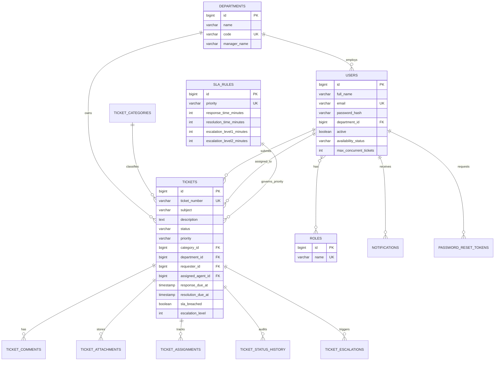

# HelpDesk Pro Enterprise Suite — Database Entity-Relationship Diagram

All 16 normalized MySQL 8 tables are provisioned via Flyway (`backend/src/main/resources/db/migration/V1__init_schema.sql`) using UTC timestamps (`TIMESTAMP(3)`).

